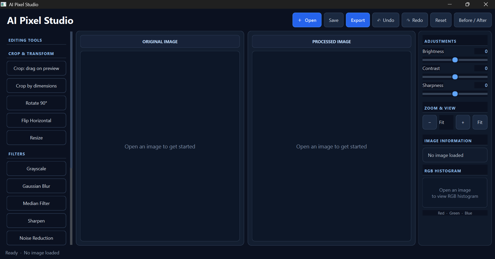
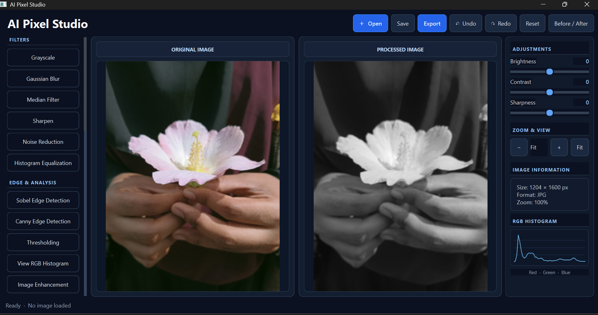
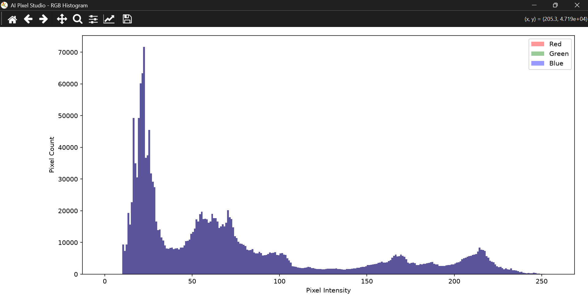

# AI Pixel Studio

A desktop image-processing application built with **Python**,
**PySide6**, **OpenCV**, **NumPy**, **Pillow**, and **Matplotlib**. It
provides a dark-themed workspace with original and processed image
previews, common image transformations, filters, image adjustments, an
RGB histogram, and export tools.

> **Project status:** The current packaged version is a classical
> image-processing desktop app. AI-related functions in the source are
> optional/prototype methods and are not exposed as active controls in
> the current main interface.

## Features

### Image loading and preview

-   Open common image formats supported by Qt/Pillow, including PNG,
    JPG/JPEG, BMP, WEBP, and TIFF.
-   View the original and processed image side by side.
-   Display image dimensions, file format, and zoom percentage.
-   Fit the image to the preview area and adjust zoom.

### Crop and transform

-   Crop by dragging a selection over the processed-image preview.
-   Crop by entering width and height.
-   Rotate by 90 degrees.
-   Flip horizontally.
-   Resize by specifying width and height.

### Filters and image analysis

-   Grayscale conversion.
-   Gaussian blur.
-   Median filter.
-   Sharpening.
-   Color noise reduction.
-   Sobel edge detection.
-   Canny edge detection.
-   Binary thresholding.
-   Histogram equalization.
-   RGB histogram in the side panel and a separate Matplotlib histogram
    window.
-   Basic classical enhancement and 2× Lanczos upscaling options.

### Adjustments and workflow

-   Brightness, contrast, and sharpness sliders with numeric values.
-   Undo and redo history.
-   Reset to the original image.
-   Before/After comparison toggle.
-   Export edited images as PNG or JPEG.
-   Keyboard shortcuts:
    -   `Ctrl+O` --- Open image
    -   `Ctrl+S` --- Save/export dialog
    -   `Ctrl+Z` --- Undo
    -   `Ctrl+Y` --- Redo
    -   `Ctrl+Shift+S` --- Save/export dialog
    -   `Ctrl+0` --- Fit to window

## Technology stack

  -----------------------------------------------------------------------
  Component                           Purpose
  ----------------------------------- -----------------------------------
  Python                              Main programming language

  PySide6 / Qt                        Desktop GUI and widgets

  OpenCV (`cv2`)                      Image filters, edge detection,
                                      thresholding, and equalization

  NumPy                               Pixel-array operations and
                                      histogram calculations

  Pillow (PIL)                        Image conversion, enhancement, and
                                      resizing

  Matplotlib                          Separate RGB histogram
                                      visualization

  PyInstaller                         Packaging the app as a Windows
                                      executable
  -----------------------------------------------------------------------

## Requirements

-   Windows 10/11 or another desktop platform supported by PySide6.
-   Python 3.11 recommended for development (the app may run on other
    compatible Python versions if dependencies are supported).
-   Dependencies listed in `requirements.txt`.

## Run from source

1.  Install Python.
2.  Open a terminal in the project directory.
3.  Create and activate a virtual environment (recommended).
4.  Install dependencies:

``` bash
python -m pip install -r requirements.txt
```

5.  Start the application:

``` bash
python main.py
```

If your working source file is named `main_professional_v5.py`, run that
filename directly or rename it to `main.py` after backing up the
existing file.

## Build a Windows executable

Install PyInstaller:

``` powershell
python -m pip install pyinstaller
```

Build in a separate output directory to avoid conflicts with an older
build:

``` powershell
python -m PyInstaller --noconfirm --clean --windowed --name AIPixelStudio_v5 --distpath release_v5 --workpath build_v5 --collect-all PySide6 main.py
```

Expected output:

``` text
release_v5/
└── AIPixelStudio_v5/
    ├── AIPixelStudio_v5.exe
    └── _internal/
```

Keep the entire `AIPixelStudio_v5` folder together. Do not distribute
only the `.exe`, because it may rely on files in `_internal`.

## Project structure

A typical working project folder may look like this:

``` text
AI-Pixel-Studio/
├── main.py
├── requirements.txt
├── ai_tools/              # optional/future AI-related code, if present
├── image_processing/      # project modules, if present
├── ui/                    # project UI modules, if present
├── utils/                 # utility modules, if present
├── build_v5/              # generated build workspace
└── release_v5/
    └── AIPixelStudio_v5/
        ├── AIPixelStudio_v5.exe
        └── _internal/
```

Generated folders can differ depending on the build command and the
current project contents.

## Testing checklist

-   [ ] Application starts from source.
-   [ ] Application starts from the packaged executable.
-   [ ] Open a supported image.
-   [ ] Apply filters and adjustments.
-   [ ] Crop, rotate, flip, and resize.
-   [ ] Undo, redo, and reset.
-   [ ] Before/After comparison.
-   [ ] RGB histogram.
-   [ ] Export PNG and JPEG.
-   [ ] Resize the application window and inspect the layout.

## Known limitations

-   The current app is a desktop editor, not a cloud application.
-   The active adjustment sliders cover brightness, contrast, and
    sharpness; other adjustments are not currently exposed as sliders.
-   Classical 2× Lanczos upscaling is interpolation, not AI
    super-resolution.
-   Optional AI background-removal and image-captioning methods require
    additional packages and model downloads and are not part of the
    current active UI workflow.
-   The application should be tested with different image sizes and
    formats before public distribution.

## Future improvements

-   Add more export formats and quality settings.
-   Add saturation and additional adjustment controls.
-   Improve crop aspect-ratio presets and zoom/pan interactions.
-   Add automated unit and GUI tests.
-   Add an application icon, version metadata, and a signed installer.
-   Integrate optional AI features only after dependencies, UI, and
    testing are ready.

## Author / course details

 **Student name:** \[FARHANA RAHMAN
\] - **Department / program:** \[CSE,BSC IN COMPUTER SCIENCE & ENGINEERING\] -
**Institution:** \[HAMDARD UNIVERSITY AND BANGLADESH\] - **Course / supervisor:**
\[DIGITAL IMAGE PROCESSING\] - **Submission date:** \[30/11/26\]


## Screenshots

### Main Interface


### Image Processing


### RGB Histogram

